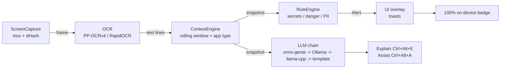

# NEXUS — On-Device Context-Aware AI Assistant

A privacy-first assistant for **Windows on Snapdragon (ARM64)** laptops. It watches
your screen **locally**: it **explains** what you're working on, **alerts** you to
secrets / risky commands / personal data, and **assists** with your task.
**No cloud. No data leaves the device.**

> Status: **M1–M4 complete and verified.** M5 (docs) here. Act mode is **roadmap
> only** (see below) — it is not built in this milestone.

---

## Pipeline



**Threading model:** capture → OCR → context → rules all run in a worker thread;
alerts are pushed through a `queue.Queue`. The UI (or CLI) lives on the Tk main
thread and polls the queue with `root.after`.

**Accelerator handling (honest):** NEXUS reports `NPU (QNN)` in the status bar
**only** when the `QNNExecutionProvider` was actually registered by ONNX Runtime
at startup. Otherwise it labels the detector `CPU` (or DirectML/CUDA). It never
fabricates an NPU claim — important for reproducible demos.

---

## Quick start

```powershell
# 1) create + activate a virtualenv, then install deps
py -3.11 -m venv .venv
.venv\Scripts\activate
pip install -r requirements.txt

# 2) run modes
python main.py --demo --ui        # interactive GUI demo (toasts + controls)
python main.py --demo --cli       # headless demo, alerts to the terminal
python main.py                    # live GUI mode (real screen)
python main.py --cli              # live headless mode
python main.py --demo --ui --once # demo that auto-closes (good for checks)

# 3) verify + test + benchmark
python scripts/check_env.py
python -m pytest tests/
python scripts/benchmark.py --iters 10            # real measurements (M4)
python scripts/benchmark.py --iters 10 --chart    # + benchmark_chart.png
```

### Run modes
| Flag | What it does |
|------|-------------|
| *(none)* | Live GUI overlay (control panel + toasts). |
| `--cli` | Headless; alerts printed to stdout (great for demos/CI). |
| `--demo` | Feed `demo_assets\*.txt` instead of live OCR — reproducible alerts. |
| `--ui` | Force GUI (default when `--cli` is absent). |
| `--once` | One iteration / demo pass then exit. |
| `--interval N` | Override capture interval (seconds). |
| `--cooldown N` | Override alert cooldown (seconds). |
| `--config PATH` | Use a custom `config.yaml`.

---

## The LLM chain (M3)

`nexus/llm.py` selects the **first available** backend from `config.yaml`:

1. **onnxruntime-genai** (Qualcomm NPU, e.g. Phi-3.5 mini quantized) — `onnx`
2. **Ollama** local server — `ollama`
3. **llama-cpp-python** GGUF — `llama_cpp`
4. **template** — deterministic, fully on-device summarizer (always present)

If no backend is installed NEXUS **still works fully**: alerts are rule-based and
Explain/Assist use the template path. Nothing ever makes a network call at runtime.

### Explain / Assist
- **Explain (Ctrl+Alt+E)** — opens a panel and *streams* "what are you working on?"
- **Assist (Ctrl+Alt+A)** — streams 2–4 grounded next-step suggestions.

Buttons in the control panel **always work**. The optional **`keyboard`** package
turns the hotkeys system-wide; without it they fire while the panel has focus.

---

## Alert rules (deterministic, no LLM)

| Category | Detection | Severity |
|----------|-----------|----------|
| `secret` | AWS / Google / OpenAI / GitHub / Slack / Stripe keys, JWTs, private-key headers, high-entropy `password=` values | critical–high |
| `dangerous_command` | `rm -rf`, `/`, `format C:`, `DROP TABLE`, `DELETE` w/o `WHERE`, `git push --force`, `curl … \| sudo sh`, `chmod -R 777` | high–medium |
| `personal_data` | Aadhaar (Verhoeff) + PAN + Luhn-valid cards | high–medium |

`RuleEngine` adds deduplication/cooldown so identical alerts don't spam.

---

## Project layout
```
main.py              entry point: wires worker + CLI/GUI dispatch
nexus/
  capture.py         mss screen grab + perceptual-hash change detection
  ocr.py             RapidOCR wrapper, NPU-aware session injection
  context.py         rolling text window + app-type heuristics
  rules.py           deterministic alert engine (secrets/danger/PII)
  llm.py             LLM backend chain + template fallback
  explain.py         Explain prompt + streaming
  assist.py          Assist prompt
  ui.py              Tkinter overlay: toasts, control panel, panels (M2/M3)
  utils.py           logging, config, backend detection, masking, hashing
scripts/
  check_env.py       environment smoke test
  benchmark.py       real on-machine measurements (M4)
tests/               pytest suite (32 tests)
demo_assets/         FAKE demo text (keys/numbers are all fabricated)
docs/                DEMO_SCRIPT.md, SUBMISSION.md
```

---

## ARM64 / Snapdragon notes
- On Windows-on-ARM install the **Microsoft arm64** `onnxruntime` build or the
  Qualcomm **`onnxruntime-qnn`** AI Hub build to unlock the `QNNExecutionProvider`.
- `opencv-python` (pulled by RapidOCR) has no native arm64 wheel yet — it runs
  under x64 emulation on Snapdragon (slower, but functional).
- GUI kept on **stdlib Tkinter** (no PySide6) to stay ARM64-clean.

Full table in `requirements.txt`; if a package refuses to install on ARM64 use the
documented workaround there rather than editing requirements blindly.

---

## Roadmap / Act mode (NOT built in this milestone)

**Act mode is documented here for scope clarity, not implemented.** The config key
`act.enabled` is `false` by default. If built later (M6), it would let the user
**approve** NEXUS running safe, reversible commands on their own device, in small
batches, with an emergency-stop hotkey (`ctrl+alt+q`). It is deliberately excluded
from the current milestone because taking actions on the user's screen adds real
safety surface and belongs in a follow-up.